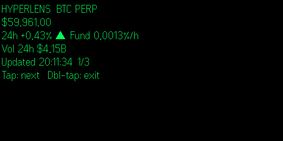
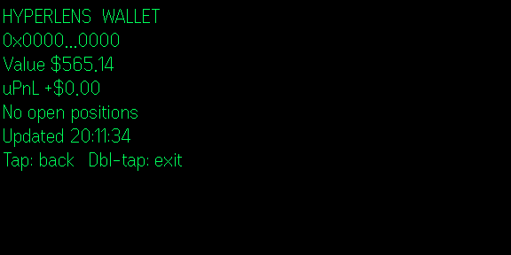

# HyperLens — heads-up Hyperliquid glance for Even G2 glasses

**Track 02 · Crypto & DeFi** — “Heads Up: Even Realities” hackathon (DoraHacks, $10,000 USDT)

> Traders check prices by pulling out their phone, unlocking it, opening an
> app, and finding the right screen. HyperLens puts the three perps that
> matter — BTC, ETH, SOL — one temple-tap away, on the lens in front of your
> eye. No keys, no funds, no financial advice: pure read-only market data.




## What it does

| Screen | Shows |
| --- | --- |
| **BTC / ETH / SOL perp** (one coin per screen) | Live mark price, 24h change, hourly funding rate, 24h volume |
| **Wallet watch** (read-only) | Account value, unrealized PnL, top open position for any Hyperliquid wallet address |
| **Alert line** | `ALERT ▲/▼ ±x.xx% in 24h!` appears on any coin that moved ≥ 5% in 24h |

- **Tap** (temple) cycles: BTC → ETH → SOL → wallet → BTC…
- **Double-tap** exits through the system confirmation dialog (`shutDownPageContainer(1)`).
- **Auto-refresh** every 30 s (15 / 30 / 60 s in settings).
- **Offline-safe:** if the Hyperliquid API is unreachable the glasses say
  `OFFLINE — retrying…` and keep the last update time. HyperLens never shows
  fake, stale-as-fresh, or hardcoded numbers.

## Who it's for

Hyperliquid perps traders who wear Even G2 glasses and want a glanceable
check — mid-workout, mid-commute, mid-meeting — without breaking focus to
open a phone. Also useful for anyone who wants a public, read-only portfolio
peek (paste any address; nothing is ever signed or sent).

## How it works

- **Glasses:** a single 576×288 text container (SDK `TextContainerProperty`,
  `isEventCapture: 1`), updated flicker-free with `textContainerUpgrade`.
  One container, one event subscription (`onEvenHubEvent`).
- **Data:** Hyperliquid public info API — `POST https://api.hyperliquid.xyz/info`
  (`metaAndAssetCtxs` for mark/funding/prev-day price, `clearinghouseState`
  for the wallet). **No API key, no account, no signing, no user funds.**
  The wallet address is stored only in the phone browser (`localStorage`).
- **Phone panel:** the same page served in a browser is the settings UI —
  watchlist toggles, wallet address, refresh interval — plus a live preview
  of exactly what the glasses show.
- **Stack:** static HTML + vanilla JS (ES module), `@evenrealities/even_hub_sdk`
  0.0.16 browser bundle, no build step, no bundler, no dependencies.
  `app.json` whitelists only `https://api.hyperliquid.xyz` for network access.

## Project status

All code in this repo was written **from scratch on 26 Nov 2026** for this
hackathon. Nothing existed before 23 Nov 2026 — no prior HyperLens code,
no prior repo, no prior submission. The Even Hub minimal template
(`even-realities/evenhub-templates`) was read as reference only; every line
of app code here is original.

Verified on this machine (26 Nov 2026, WIB):
- Even Hub simulator 0.9.5 under Xvfb — all four screens render with live
  data (BTC $59,961.00 +0.43%, ETH $1,681.90 +0.36%, SOL $70.34 +1.74%,
  wallet 0x0000…0000 value $565.14), tap-cycling works, double-tap calls
  `ShutDownPageContainer`, zero console errors. Screenshots in `test-shots/`.
- Phone panel in headless Chromium — live prices, wallet save/validation,
  watchlist and interval settings all work.
- Packaged with the Even Hub CLI 0.2.0: `hyperlens.ehpk`.

## Setup

### Simulator (no glasses needed)

```bash
# 1. Serve the app (any static server; port 5173 matches the docs)
python3 -m http.server 5173

# 2. In another terminal, run the simulator against it
evenhub-simulator http://localhost:5173 --automation-port 9898
```

Click the simulator canvas to cycle coins; double-click to exit.
Headless checks: `GET /api/ping`, `GET /api/screenshot/glasses`,
`POST /api/input {"action":"click"}` — see `../sim-test.py` in the build
notes (kept outside this repo).

### Real G2 glasses (QR sideload)

```bash
evenhub qr --url "http://<YOUR-LAN-IP>:5173"
```

Tap **Scan QR** in the Even phone app and aim it at the terminal.
Temple tap cycles, double-tap exits. The phone panel (same URL in a
browser) configures the wallet address and watchlist.

### Package (.ehpk)

```bash
node <path-to-evenhub-cli>/main.js pack app.json dist
# → hyperlens.ehpk
```

`dist/` is a plain copy of `index.html`, `app.js`, `sdk/` and `icon.png`.
No login is needed to pack; `create`/`upload` need an Even account.

## Feature requests (for Even Realities / Hyperliquid)

1. **WebSocket push to glasses** — let an app hold one live socket and push
   ticks to the lens, instead of polling the REST API every 30 s.
2. **Native on-glass price-alert API** — a system alert (haptic/visual) when
   a watched symbol moves more than X% — today HyperLens can only print a
   line and wait for the next tap.
3. **Hyperliquid: funding-rate-change events on the public WebSocket** — so
   a glanceable app can react to funding flips without polling `metaAndAssetCtxs`.
4. **Background refresh permission** — keep the glance live when the phone
   locks, instead of freezing the WebView with the screen.
5. **Glance complications on the G2 home screen** — pin one HyperLens line
   (e.g. `BTC $59,961 ▲0.43%`) next to the clock, launchable with one tap.

## Safety & money

- **Read-only.** HyperLens only calls Hyperliquid's public `info` endpoint.
  It never asks for a private key, seed phrase, or API key; never signs a
  transaction; never touches user funds.
- **No secrets in this repo.** There are no keys, tokens, or credentials
  anywhere in the code, history, or assets. The only network host is
  `https://api.hyperliquid.xyz`.
- **No financial advice.** Prices, funding rates and PnL are market data,
  not a recommendation to buy, sell, or hold anything. Do your own research.

## Files

```
hyperlens/
├── index.html          phone panel + glasses webview entry
├── app.js              all app logic (data, glasses render, events, panel)
├── sdk/
│   └── even_hub_sdk.js @evenrealities/even_hub_sdk 0.0.16 (browser ESM bundle)
├── app.json            Even Hub manifest (com.jabrik78.hyperlens)
├── icon.png            24×24 greyscale app icon
├── test-shots/         simulator screenshots (live-data proof)
└── hyperlens.ehpk      packaged app (built with evenhub-cli 0.2.0)
```

## License

MIT. The SDK bundle in `sdk/` is © Even Realities, MIT-licensed (see `sdk/LICENSE`).
